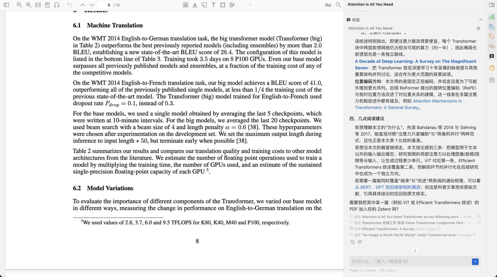
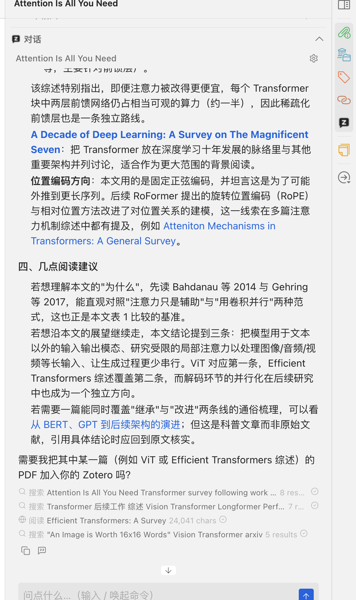
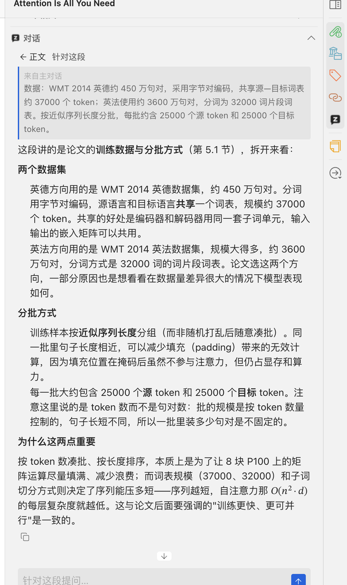
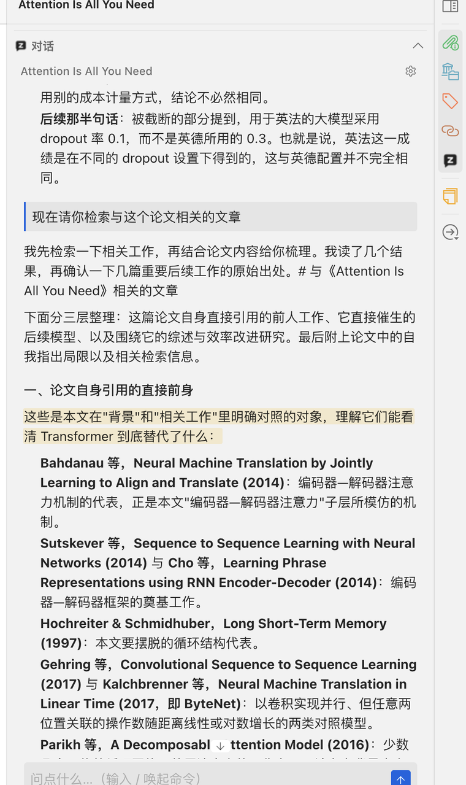
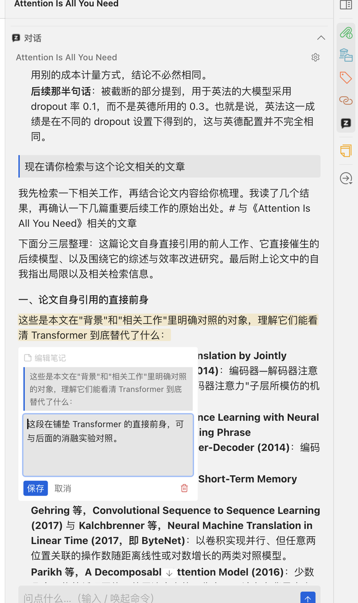
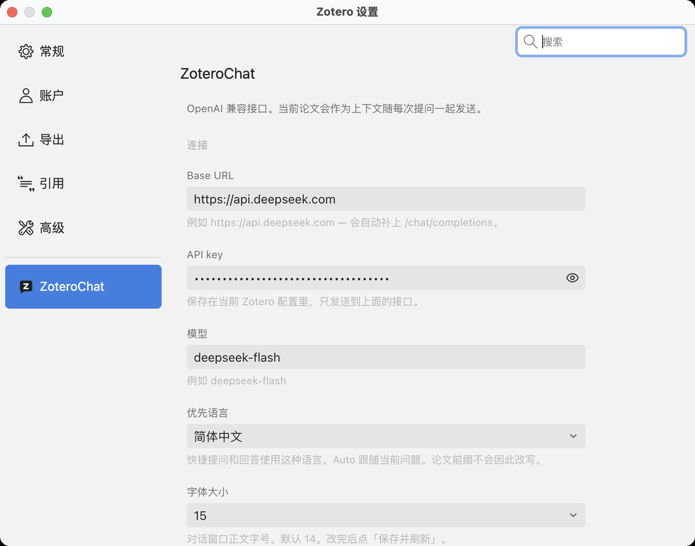

<p align="center">
  
</p>

<p align="center"><strong>Read the paper. Ask it anything.</strong></p>
<p align="center">Read · Search · Annotate · Collect</p>

<p align="center">
  <a href="https://github.com/TianSuya/ZoteroChat/releases/latest">Download latest</a> ·
  <a href="README.zh-CN.md">简体中文</a> ·
  <a href="docs/">Documentation</a> ·
  <a href="docs/changelog.md">Changelog</a>
</p>

---

ZoteroChat turns Zotero's right sidebar into a reading companion. The paper you have open stays in context, so you never have to explain it again. When a sentence is unclear, ask about it, search beyond the paper, or bring a related paper into your library without leaving the reader.

Conversations are saved per PDF. Close Zotero, come back tomorrow, open the same paper: the thread, tool history, and your notes are still there.

<p align="center">
  
</p>

## Why it feels different

- **The paper is the main character.** Open a PDF and the full text plus metadata are already in context. Follow-ups stay grounded, and Markdown, tables, and LaTeX render in the sidebar.
- **Reading is not interrupted.** Explain a selection, open a side conversation, or write a note right where you are. No tab juggling between the PDF and a separate chat app.
- **It can check, not just remember.** When outside information matters, the assistant can call DeepSeek Search / Fetch, cite the pages it read, and show a compact tool trace.
- **Your library stays yours.** Papers are never written to Zotero without confirmation. Conversations and notes live in a local sqlite database in your profile.

## Search without leaving the paper

Ask about related work, publication status, or where a claim came from. The assistant searches the web, reads promising pages, and answers with links.

- Search and Fetch work in the main thread and in **Ask about selection** overlays.
- Sources are clickable Markdown links.
- Every search and fetch appears as a compact tool record below the answer, including failures and their reasons.

<p align="center">
  
</p>

<p align="center"><sub>Search, fetch, and citations stay attached to the answer.</sub></p>

## A side conversation for one sentence

Select a sentence in an assistant reply and choose **Ask about selection**. A short overlay opens on top of the main thread. Close it with **← Main thread** or Esc and you are back exactly where you left off.

The side conversation reuses the same paper prefix, so it does not re-read the paper, and it does not stretch the main timeline. A small marker stays under the original sentence so you can reopen it later.

<p align="center">
  
</p>

<p align="center"><sub>The overlay covers only the sidebar; the main thread does not move.</sub></p>

## Notes on the exact sentence

Select text in the conversation and choose **Add note**. The sentence gets a warm inline highlight, distinct from the blue underline used by side conversations. Click the highlight to edit or delete the note.

- Notes are stored by message and quote, and restore when you reopen the PDF.
- Notes are **never sent to the model** and never change the conversation prefix.
- No separate note-taking app: read, think, annotate in place.

<table>
  <tr>
    <td width="50%" align="center" valign="top">
      <br>
      <sub>The quoted sentence is highlighted in place</sub>
    </td>
    <td width="50%" align="center" valign="top">
      <br>
      <sub>Click the highlight to edit or delete</sub>
    </td>
  </tr>
</table>

## It asks before it guesses

Some choices cannot be inferred from the paper. When a decision matters, the assistant shows a question card above the composer with quick options, free text, and a skip action. The answer goes back to the model as a tool result.

## Nothing enters Zotero without confirmation

When you explicitly ask to save a paper, the assistant proposes an item first: title, source, DOI, year, authors. Only after you confirm does it download the PDF, validate it, de-duplicate by DOI, and create the item in the current paper's library and collections.

- Every library write is confirmed; nothing is added in the background.
- Only public http(s) URLs are accepted; the downloaded file is checked for PDF magic bytes and size.
- Direct PDF links, arXiv, and OpenReview are handled. Publisher pages that require login or CAPTCHA may fail, with the reason shown in the tool trace.

## Close it. Come back. It is still there.

Conversations are stored per PDF in `zoterochat.sqlite` in the current Zotero profile. Messages are append-only. Reopening a paper restores:

- the main thread and side conversations
- search / fetch / paper-import tool records
- your notes

**New conversation** archives the current thread and starts a blank one; it does not delete the old records.

## Install

1. Download the latest `zotero-chat.xpi` from [Releases](https://github.com/TianSuya/ZoteroChat/releases/latest).
2. In Zotero, open **Tools → Plugins → gear → Install Plugin From File…** and select the XPI.
3. Restart Zotero and open **Zotero → Settings → ZoteroChat** (Windows/Linux: **Edit → Settings**).
4. Enter your Base URL, API key, and model. For web search, add a search key or leave it empty to reuse the main key.
5. Open a PDF in the reader and click the chat icon in the right sidebar.

## Configuration

| Setting         | Default                    | Notes                                                                      |
| --------------- | -------------------------- | -------------------------------------------------------------------------- |
| Base URL        | `https://api.deepseek.com` | OpenAI-compatible Chat Completions endpoint                                |
| Model           | `deepseek-flash`           | Any model that supports tool calls                                         |
| API key         | Empty                      | Stored in the current Zotero profile                                       |
| Search API key  | Empty                      | Falls back to the main key; Search/Fetch are billed per successful request |
| Search Base URL | `https://api.deepseek.com` | `/v1/tools/...` is appended automatically                                  |
| Reply language  | Simplified Chinese         | Used by quick prompts and answers; does not change the paper prefix        |

<p align="center">
  
</p>

## Compatibility and limitations

- Development validation is on **Zotero 9.0.6 / Gecko 140**. Zotero 7 and 8 are compatibility targets, but the full matrix is not yet tested on real machines.
- The endpoint must support Chat Completions; search, fetch, Ask User, and paper import also need tool-calling support.
- Paper download covers direct PDF links, arXiv, and OpenReview. Publisher pages that require login, CAPTCHA, or extra navigation may fail.
- A pending Ask User question is not restored after a panel reload; completed turns remain in history.
- Notes currently stay in the current profile. They are not exported to Zotero notes or synced across devices.
- Automatic compression for very long papers and context-limit warnings are not implemented yet.

## Development

```bash
npm ci
npm run check          # lint + format + typecheck + tests
npm run build:production
npm start              # isolated dev Zotero instance
```

Architecture, cache strategy, Zotero pitfalls, and ADRs live in [docs/](docs/). Start with [overview.md](docs/overview.md), [architecture.md](docs/architecture.md), and [environment.md](docs/environment.md).

## Data and privacy

PDF text is extracted locally by Zotero. When you send a question, the configured model endpoint receives the paper text, bibliographic metadata, conversation history, your question, and any attached selection. The plugin sends text, not the PDF file itself.

The API key is stored in the current Zotero profile's preferences, not in a separate encrypted credential store. Conversations and notes live in `zoterochat.sqlite` in that profile. Search and Fetch requests go to the configured search endpoint; billing and data retention are governed by that provider.

## License

[PolyForm Noncommercial 1.0.0](LICENSE.md). Commercial use requires a separate written license. When redistributing, include the license text or its official URL.

Required Notice: Copyright (c) 2026 bowentian
